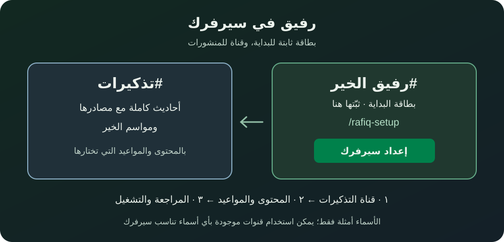

# إعداد رفيق في سيرفرك

1. أنشئ قناة نصية مثل **رفيق الخير**، وافتحها واكتب **`/rafiq-setup`**. تظهر بطاقة البداية في القناة نفسها؛ ثبّتها من قائمة الرسالة. الاسم مثال فقط ويمكنك اختيار غيره.
2. أنشئ قناة أخرى مثل **تذكيرات**، أو استخدم قناة موجودة. اسمح للأعضاء بقراءتها، ويمكنك حصر الكتابة في البوت والمشرفين.
3. اضغط **إعداد سيرفرك** في البطاقة: اختر قناة التذكيرات، ثم المحتوى والمواعيد والمنشن، ثم راجع واضغط **حفظ وتفعيل النشر**.

**للأعضاء:** «ابدأ مع رفيق» يفتح إعداداتك لك وحدك، و«أقرأ الآن» يفتح المكتبة. منشورات السيرفر لا تشترك بك تلقائيًا في التذكيرات الخاصة.

**للمشرف:** اختر ١ أو ٢ أو ٣ تذكيرات يوميًا، أو أوقف اليومية واكتفِ بمواسم الخير. المنشن اختياري: بدون منشن أو رتبة أو الجميع؛ يظهر اختيارك في المعاينة قبل الحفظ. لا تُرسل المعاينة رسالة أو منشنًا في القناة.

الأسماء أمثلة؛ تستطيع استخدام أي أسماء وقنوات نصية موجودة. يمكن جمع البطاقة والمنشورات في قناة واحدة، لكن فصلهما يجعل البطاقة أسهل وصولًا. الأوامر لا تنشئ قنوات أو تمنح صلاحيات تلقائيًا.

## لاحقًا

- **التعديل أو الإيقاف:** `/rafiq-server` أو «إعدادات هذا السيرفر» من الرئيسية الشخصية للمشرف.
- **تحديث البطاقة:** أعد `/rafiq-setup` في القناة نفسها؛ يحدث البطاقة بدل تكرارها. لن تتغير إعدادات النشر أو المشتركين.
- **بطاقة في قناة أخرى:** لحماية السيرفر من تكرار البطاقات، افتح رابط البطاقة السابقة واحذفها أولًا، ثم أعد الأمر في المكان الجديد.
- **قناة البطاقة للقراءة فقط:** يمكن للمشرف استخدام `/rafiq-setup channel:...` من قناة يستطيع الكتابة فيها، مع امتلاك صلاحية الإرسال في قناة البطاقة أيضًا.
- **الصلاحيات:** إدارة السيرفر للمشرف؛ عرض القناة والإرسال وإرفاق الملفات وقراءة سجل الرسائل للبوت. لا يحتاج صلاحية «مسؤول». ثبّت البطاقة يدويًا إذا كانت لديك صلاحية التثبيت.

راجع [تفاصيل المنشورات والصلاحيات](server-posts.md) عند الحاجة.
